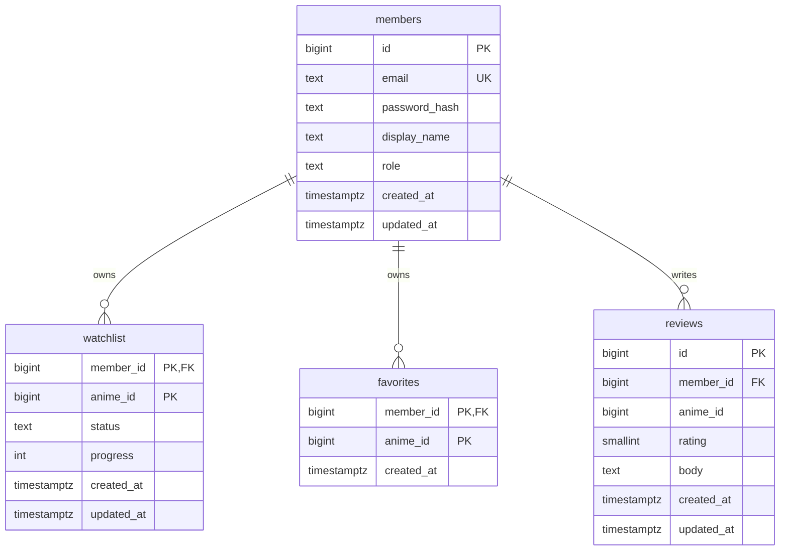

# AniWatchlist: ฐานข้อมูลสำหรับ Go API + Supabase

เอกสารนี้ออกแบบตามโปรเจกต์ AniWatchlist ปัจจุบัน: หน้าเว็บใช้ AniList สำหรับข้อมูลอนิเมะ และใช้ Go API ที่ deploy บน Render เพื่อจัดการบัญชี, watchlist, favorites และรีวิว PostgreSQL อยู่บน Supabase

ไฟล์ SQL สำหรับสร้างตารางอยู่ที่ [`docs/db/schema.sql`](db/schema.sql) (อ้างอิงจากโฟลเดอร์ `frontend/`)

```bash
psql "$DATABASE_URL" -f docs/db/schema.sql
```

## ขอบเขตข้อมูล

- เก็บเฉพาะข้อมูลที่ผู้ใช้สร้างหรือข้อมูลบัญชีของ AniWatchlist
- `anime_id` ใช้ AniList media ID (`BIGINT`) เป็นตัวอ้างอิง
- ไม่สร้างตาราง catalog ของอนิเมะ เพราะข้อมูลชื่อ, รูป, เรื่องย่อ และ genre มาจาก AniList อยู่แล้ว
- รีวิวเก็บในฐานข้อมูลของแอปเอง ไม่ query รีวิวจาก AniList หรือเว็บอื่น
- schema นี้สมมติให้ Go จัดการ register/login เอง โดยเก็บ password เป็น bcrypt hash และออก JWT; ห้ามเก็บรหัสผ่านดิบ

## ตารางและความสัมพันธ์



`members.email` unique แบบไม่สนตัวพิมพ์เล็ก/ใหญ่; watchlist และ favorites มีได้หนึ่งรายการต่อสมาชิกต่ออนิเมะ ส่วนรีวิวรองรับหลายรีวิวจากสมาชิกคนเดิมต่ออนิเมะ เพื่อให้ตรงกับ mock API ปัจจุบันที่เพิ่มรีวิวใหม่ทุกครั้งที่โพสต์

## การเชื่อมกับ API ปัจจุบัน

| Go API | ตาราง | หมายเหตุ |
|---|---|---|
| `POST /api/auth/register` | `members` | รับ email/password; hash password ด้วย bcrypt ก่อน insert |
| `POST /api/auth/login` | `members` | ตรวจ bcrypt hash แล้วคืน user และ JWT |
| `GET /api/watchlist` | `watchlist` | ใช้ member ID จาก JWT; คืนรายการของผู้ใช้ปัจจุบัน |
| `POST /api/watchlist` | `watchlist` | body `{ "animeId": 16498, "status": "planned", "progress": 0 }`; upsert ตาม `(member_id, anime_id)` |
| `GET /api/favorites` | `favorites` | คืนรายการของผู้ใช้; `?animeId=...` คืน count และ favorited |
| `POST /api/favorites` | `favorites` | body `{ "animeId": 16498 }`; ทำซ้ำแล้วไม่สร้างแถวซ้ำ |
| `DELETE /api/favorites/{animeId}` | `favorites` | ลบ favorite ของผู้ใช้ปัจจุบัน |
| `GET /api/reviews?animeId=...` | `reviews`, `members` | คืนเฉพาะรีวิวที่ผู้ใช้เขียนในแอป; join display name |
| `POST /api/reviews` | `reviews` | body `{ "animeId": 16498, "rating": 8, "text": "..." }`; rating 1–10, body 1–2000 ตัวอักษร |

ทุก endpoint ที่ต้องเข้าสู่ระบบต้องอ่าน `member_id` จาก JWT ที่ตรวจสอบแล้วเท่านั้น ห้ามรับ `member_id` จาก body หรือ query string ส่วนข้อมูลอนิเมะสำหรับแสดงผลยังโหลดจาก AniList ตามที่ frontend ทำอยู่

## Authentication ที่ต้องทำใน Go

ตาราง `members` เป็นบัญชีของแอป ไม่ใช่ Supabase Auth โดยตรง เพราะ frontend ปัจจุบันเรียก `/api/auth/register` และ `/api/auth/login` แล้วรับ `{ user, token }` กลับมา Go จึงต้อง:

1. ตรวจ email และ password ที่รับเข้ามา
2. เก็บ `bcrypt` hash เท่านั้น
3. login ด้วยการตรวจ hash และออก JWT ที่มี member ID
4. ตรวจลายเซ็นและวันหมดอายุ JWT ก่อนให้เข้าถึง watchlist, favorites หรือ reviews

ถ้าจะเปลี่ยนไปใช้ Supabase Auth แทน ต้องปรับ contract ฝั่ง frontend และใช้ Supabase user UUID เชื่อมกับตารางข้อมูลผู้ใช้ ไม่ควรเก็บรหัสผ่านซ้ำใน `members`

## ข้อควรรู้

- `watchlist.status` รองรับ `planned`, `watching`, `completed`, `paused`, `dropped`; UI ปัจจุบันใช้ `planned` เป็นหลัก
- `progress` เป็นจำนวนตอนที่ดูแล้ว และต้องไม่ติดลบ
- ไม่มี FK จาก `anime_id` ไปยังตารางอนิเมะ เพราะ AniList เป็นเจ้าของข้อมูล catalog และ ID ที่ผู้ใช้บันทึกอาจยังไม่มีใน mock seed
- รีวิวที่ลบสมาชิกเป็นของสมาชิกคนนั้น จึงลบตามด้วย `ON DELETE CASCADE`; หากต้องเก็บรีวิวไว้หลังลบบัญชี ให้เปลี่ยนเป็น anonymize แทน cascade
- Supabase connection string (`DATABASE_URL`) ใส่ใน Environment ของ Render เท่านั้น ห้ามใส่ใน frontend หรือ commit ลง Git
